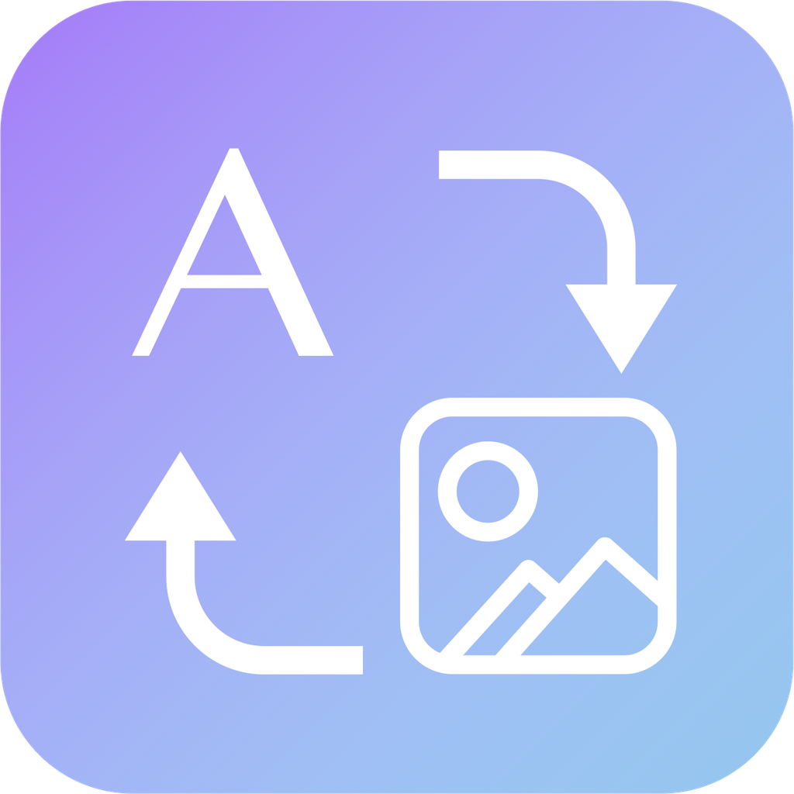

# AI 文生图提示词工作台

[](../../actions/workflows/build.yml)
[](LICENSE)

一个**本地运行**的 AI 绘画提示词编辑器：分类标签库 · 中英对照 · 智能推荐 · 权重编辑 · 大模型润色 · 图片反推。
数据全部存在自己电脑上，只有一个可选的「调用大模型」功能会联网，其余全部离线。

**2134 个内置标签**（18 个分类 / 137 个分组），标签库可任意增删改、拖拽归类。



## 下载

到 [Releases](../../releases) 页下载对应平台的包：

| 平台 | 文件 | 说明 |
| --- | --- | --- |
| **macOS** | `AI-Prompt-Studio-macOS.zip` | 解压得到 `.app`，拖进「应用程序」。**免装 Python** |
| **Windows** | `AI-Prompt-Studio-Windows.zip` | 解压后双击 `PromptStudio.exe`。**免装 Python** |

> macOS 首次打开如果提示"无法验证开发者"：右键点 App →「打开」→ 再点「打开」。
> （因为没做 Apple 开发者签名，属于正常现象。）

## 主要功能

| | |
| --- | --- |
| **分类标签库** | 18 类 2134 个标签，全部中英对照；分类 / 分组 / 标签都能拖拽自由归类 |
| **提示词编辑** | 逗号分段成芯片、拖拽排序、一键打乱、权重 `(tag:1.3)` 双向读写、单个标签停用 |
| **智能推荐** | 三路并行：按输入预测 · 按历史常用组合 · 同类推荐 |
| **中→英** | 用内置词库离线翻译，连写中文也能拆（`红眼睛少女` → `red eyes, teenage girl`） |
| **AI 润色** | 5 种润色方式 × 3 种输出目标（SD / Midjourney / 自然语言），可勾选权重建议 |
| **AI 翻译** | 中英互译，走你自己配置的大模型接口 |
| **图片反推** | 上传图片 → 大模型解析出提示词，解析模板可自定义 |
| **负面模板** | 8 套常用负面词，一键替换或追加 |
| **随机灵感** | 6 套主题，按维度从词库随机抽词，一次给 3 个方案 |
| **方案槽位** | 4 个槽位存取对比，逐标签标出「共有 / 独有」 |
| **复制格式** | 正负一起复制，前缀可配（`Positive prompt:` / `Negative prompt:`） |
| **其他** | 撤销重做（80 步）· 深色/浅色/跟随系统 · 快捷键 · 工程导入导出 |

## 从源码运行

不需要装任何依赖（纯 Python 标准库）：

```bash
python3 server.py
```

或者双击 `启动.command`（macOS）/ `启动.bat`（Windows）。浏览器会打开 <http://127.0.0.1:8765/>。

## 自己打包

```bash
python3 tools/build.py
```

会自动装 PyInstaller（装到项目内 `build/`，不动系统环境）、生成图标、打包。
**注意：PyInstaller 不能跨平台编译 —— 造 `.exe` 必须在 Windows 上跑。**

macOS 的 `.app` 额外需要 Xcode 命令行工具（提供 `swiftc`）：`xcode-select --install`。

仓库里带了 GitHub Actions（[.github/workflows/build.yml](.github/workflows/build.yml)），
推 tag 就会在两个平台上自动打包并发 Release。

### 发一个新版本

```bash
git tag v1.0.0
git push origin v1.0.0
```

CI 会跑三个任务：前端断言 → macOS 打包 → Windows 打包，
全部通过后自动建 Release，把 `AI-Prompt-Studio-macOS.zip` 和 `AI-Prompt-Studio-Windows.zip` 挂上去。

只想拿构建产物不发版：推任意提交后在仓库的 **Actions** 页面下载 Artifacts。

---

一个本地运行的提示词编辑器：**分类标签 · 中英对照 · 智能推荐 · 图片反推**。
零依赖（只用 Python 标准库），数据全部存在你自己电脑上。

当前标签库：**18 个分类 / 137 个分组 / 2134 个标签**，可在界面里随意增删改。

---

## 一、启动

### 方式 A：macOS App（推荐，免装 Python）

双击 **`AI提示词工作台.app`** —— **直接弹出一个原生窗口**，不会跳浏览器、看不到任何 `127.0.0.1` 地址。

首次打开如果被 Gatekeeper 拦住：右键点它 →「打开」→ 再点一次「打开」，之后就能直接双击了。

**它是一个真的 macOS App，不是一个包着网页的壳：**

| | |
| --- | --- |
| **窗口** | 原生 `NSWindow` + `WKWebView`，标题栏、最小化、缩放、全屏都正常 |
| **菜单栏** | 有「应用 / 编辑 / 视图 / 帮助」四个菜单，⌘C ⌘V ⌘A ⌘Q ⌘R 全部可用 |
| **Dock** | 有自己的图标和名字，⌘Q 或关窗口即退出 |
| **导出文件** | 走**系统保存对话框**（原生 `NSSavePanel`），能自己选存到哪 |
| **窗口位置** | 会记住上次的大小和位置 |
| **界面偏好** | 主题默认**跟随系统**，语言默认**中英对照** |
| **缩放** | ⌘+ / ⌘- / ⌘0 缩放界面 |
| **数据目录** | 菜单「帮助 → 打开数据目录」，或「查看运行日志」 |

架构：`Contents/MacOS/PromptStudioApp`（Swift 原生窗口）启动时把
`Contents/Frameworks/PromptStudio`（Python 本地服务）拉起来当子进程，
探测到端口后把界面加载进窗口。关窗口会把子进程一起带走，不留孤儿进程占端口。

- 数据存在 `~/Library/Application Support/AI-Prompt-Studio/`，App 本体保持只读
- 重复双击不会开出第二个实例

### 恢复到出厂状态

想清空所有使用痕迹（历史组合、收藏、自定义标签库、界面偏好），把数据目录整个删掉即可，
下次启动会自动重建：

```bash
rm -rf ~/Library/Application\ Support/AI-Prompt-Studio
```

源码模式（`启动.command`）的数据在项目里的 `data/` 目录，同样删掉即可。
两个目录互不影响，App 只认前者。

### 出问题怎么查

数据目录 `~/Library/Application Support/AI-Prompt-Studio/` 下有两份日志：

| 文件 | 内容 |
| --- | --- |
| `native.log` | 原生外壳：窗口尺寸、页面加载结果、**DOM 渲染自检**（分类数 / 标签数 / 实际渲染宽度） |
| `app.log` | Python 本地服务：端口、数据目录、接口报错 |

菜单「帮助 → 查看运行日志」直接打开 `app.log`；`native.log` 里如果看到
`webView=0×0` 之类，那就是渲染尺寸出了问题，而不是数据没加载。

想自己重新打包：`bash tools/build_app.sh`（产物在 `build/dist/`，需要 Xcode 命令行工具提供 `swiftc`）。

### 换 App 图标

拿一张图片（PNG / JPG，或者直接用 PDF 渲染）生成符合 macOS 规范的图标：

```bash
PY=~/.dsh/dsh-runtimes/dsh-primary-runtime/dependencies/python/bin/python3
"$PY" tools/import_icon.py 你的图标.png                    # 图片
"$PY" tools/import_icon.py 你的图标.pdf --from-pdf         # PDF
"$PY" tools/import_icon.py 你的图标.pdf --from-pdf --content 900   # 内容再大一点
bash tools/build_app.sh                                    # 重新打包
```

脚本会自动裁到内容包围盒、按 Apple 的图标网格缩放居中，再交给打包脚本转成 `.icns`。
`--content` 控制内容在 1024 画布里占多少（默认 824 = Apple 标准；线条细的图标建议 900）。

### 方式 B：源码运行（需要机器上有 Python 3）

| 系统 | 操作 |
| --- | --- |
| macOS | 双击 `启动.command` |
| Windows | 双击 `启动.bat` |
| 命令行 | `python3 server.py` |

这种方式数据存在项目里的 `data/` 目录。

启动后自动打开浏览器，地址一般是 <http://127.0.0.1:8765/>。
**关闭那个终端窗口 = 关闭软件。**

> ⚠️ 不要直接双击 `app/index.html`，那样页面读不到数据。必须通过启动脚本运行。

---

## 二、界面

```
┌───────────────────────────────────────────────────────────────────┐
│ 顶栏                          图片反推 标签管理 设置 │ 🌐语言 │ ◐主题 │
├──────────┬───────────────────────┬────────────────────────────────┤
│  分类     │   标签库（可搜索）      │  正向提示词 / 负面提示词         │
│  场景     │   ▸ 自然风光           │  智能推荐                       │
│  人物     │     [森林][山脉]…      │  收藏 / 我的组合 / 重置          │
│  …        │   ▸ 城市建筑           │                                │
└──────────┴───────────────────────┴────────────────────────────────┘
```

### 主题（右上角按钮，单击循环）
**跟随系统 → 浅色 → 深色 → 跟随系统**，默认跟随系统。
图标是太阳 / 月亮 / 显示器，选择会记进 `data/settings.json`，下次打开保持。

### 语言（右上角下拉）
`中文` / `English` / `中英对照` 三档。切换后分类名、标签、芯片、推荐全部实时跟随。

### 左侧分类栏：拖动排序

主界面左侧的分类列表可以直接拖：

- 按住任意分类上下拖动，落点会亮起蓝色插入线（上半边=插到前面，下半边=插到后面）
- 拖到最上面的「**全部标签**」上 = 移到第一位
- 松手即保存，顺序立刻生效，**标签管理弹窗里的分类顺序会同步**
- 「全部标签」本身固定在顶部、不可拖动
- 悬停分类时右侧的数字会淡出、出现一个抓点图标，提示这里可以拖
- 面板底部有一行小字「拖动分类可调整顺序」

> 顺带说一句：原来的分类项是 `<button>`，而 `<button>` 的 `draggable` 在部分浏览器不生效，
> 所以改成了 `role="button" tabindex="0"` 的 `<div>`，Enter / 空格 依旧可以选中。

### 标签操作
- **点标签** → 英文自动拼进提示词框；**再点一次** → 移除。
- 芯片上悬停会出现三个按钮：**设权重 / 停用 / 移除**。

### 复制（正 / 负 / 一起）

| 入口 | 复制内容 |
| --- | --- |
| 正向块右上角「复制」 | 只复制正向 |
| 负面块右上角「复制」 | 只复制负面 |
| 底部 **「复制全部」**（蓝色高亮） | **一次把正面 + 负面都复制**，中间空一行 |
| `Ctrl/Cmd + Shift + C` | 同「复制全部」 |

**前缀格式在 设置 → 复制格式 里调**，三档任选：

| 模式 | 复制出来长这样 |
| --- | --- |
| 都不加 | `1girl, forest` ⏎⏎ `low quality` |
| **只给负面加**（默认） | `1girl, forest` ⏎⏎ `Negative prompt: low quality` |
| 正面和负面都加 | `Positive prompt: 1girl, forest` ⏎⏎ `Negative prompt: low quality` |

正负前缀的文字本身也能改（默认 `Positive prompt: ` / `Negative prompt: `），
设置里有一块**实时预览**，改一个字就能看到最终复制效果。

这个设置对所有复制入口统一生效：三个复制按钮、收藏组合的「复制」、方案槽位的「复制」、润色结果的「复制」。
（工程导出的 TXT 文件不受影响，它始终自带 `Negative prompt:` 标签，保证文件自己能读得懂。）

---

## 三、提示词编辑

提示词被拆成**逗号分隔的片段**，每个片段就是一张芯片；未收录进词库的片段也会显示成虚线芯片，方便你继续改。

| 操作 | 做法 |
| --- | --- |
| **排序** | 按住芯片拖到目标位置，左侧会亮起蓝线提示落点；拖到空白处 = 移到末尾 |
| **打乱** | 标题栏的「打乱」按钮，一键随机重排 |
| **权重** | 点芯片上的天平按钮（或直接点 `×1.3` 徽标）输入权重，范围 0.1 – 3.0 |
| **清权重** | 标题栏「清权重」，把 `(tag:1.3)` 全部还原成 `tag` |
| **停用** | 点芯片上的暂停按钮，标签从提示词里移出、进入下方「已停用」区；点一下就恢复 |
| **移除** | 点芯片上的 ✕ |

### 权重语法（与 A1111 / ComfyUI 一致，双向可读可写）

| 你写的 | 解析成 | 本工具写回的样子 |
| --- | --- | --- |
| `masterpiece` | 无权重 | `masterpiece` |
| `(masterpiece)` | 1.10 | `(masterpiece:1.1)` |
| `((masterpiece))` | 1.21 | `(masterpiece:1.21)` |
| `[masterpiece]` | 0.90 | `(masterpiece:0.9)` |
| `(masterpiece:1.4)` | 1.40 | `(masterpiece:1.4)` |

也就是说：**手写的权重会被识别并显示在芯片上，用界面调权重也会写回标准语法**，粘到别的工具里直接用。

---

## 四、效率工具（工作区顶部工具条）

| 工具 | 说明 |
| --- | --- |
| **中→英** | 用**内置 2134 个标签的词库**把中文片段换成英文标签。**不联网、瞬时完成**，支持把「红眼睛少女」这种连写的中文自动拆成 `red eyes, teenage girl`。词库里没有的片段会原样保留并提示 |
| **AI 翻译** | 调「设置」里配置的 OpenAI 兼容接口做中英互译，自由文本也能译。两个方向：`中文 → 英文提示词`、`英文 → 中文对照`；译文可直接「应用到正向」 |
| **AI 润色** | **写完提示词后的调优**：5 种润色方式 × 3 种输出目标，返回润色结果 + 标签级变化 + 模型说明。详见下一节 |
| **负面模板** | 8 套内置负面词：通用去瑕疵 / 人像优化 / 写实摄影 / 动漫插画 / 概念设计 / 风景建筑 / 产品静物 / 极简干净。支持「替换」或「追加」（追加会自动去重） |
| **随机灵感** | 6 套主题（人物肖像 / 奇幻场景 / 赛博朋克 / 自然风景 / 美食静物 / 机甲科幻），每套按维度从词库随机抽词，一次生成 **3 个候选方案**，可「换一批」、可替换或追加到正向提示词 |
| **撤销 / 重做** | 最多 80 步，覆盖手工输入、标签增删、排序、权重、模板套用、灵感应用等所有改动 |

模板与灵感配置都在 [app/data/templates.json](ai-prompt-studio/app/data/templates.json)，可以直接改或自己加主题。

---

## 五、AI 提示词润色

写完提示词后点工具条的 **AI 润色**（或 `Alt + P`），让大模型帮你调优。

### 5 种润色方式

| 方式 | 做什么 |
| --- | --- |
| **均衡调优** | 保持原意，补齐缺失的光线 / 构图 / 画质维度，并按标准顺序重排，不凭空添加新主体 |
| **丰富细节** | 主体不变，大幅补充材质、光影、环境、氛围、镜头等细节，让画面更饱满 |
| **精简凝练** | 做减法：删掉重复、冲突和低影响力的词，精简到最关键的 20–35 个 |
| **规范排序** | **只**调整顺序和格式，不新增、不删除、不替换任何关键词 |
| **纠错修正** | **只**修正拼写、语法、模型不认的写法（中文/句号/引号）和互相冲突的词 |

### 3 种输出目标

| 目标 | 输出形态 |
| --- | --- |
| **标签式** | 全小写英文关键词，逗号分隔，支持 `(关键词:权重)` —— 适合 SD / ComfyUI / NovelAI |
| **Midjourney** | 英文自然短语 + 逗号分隔，末尾自动附 `--ar` / `--stylize` 参数 |
| **自然语言** | 2–4 句连贯英文描述 —— 适合 Flux / DALL·E / GPT-Image |

**三种目标的正向 / 负向都会分开输出**，不会混在一个框里。

Midjourney 模式下多一个「**合成 --no**」按钮：
因为 MJ 的负面提示词语法是 `--no xxx`，而工具里正负是分开编辑的，
所以你改完负面之后点一下这个按钮，它会把负面拼成 `--no xxx` 追加到正向末尾，
变成可以直接粘进 MJ 的完整指令。重复点不会叠加。

> 如果模型没按格式输出（比如整段写成了一句话），解析器也有兜底：
> 会自动把 `说明` / `WEIGHTS` 从提示词里切掉，并把混进正向的 `--no` 拆分到负向。

### 额外要求（可选）
一个输入框，优先级最高。例如「加强雨天氛围」「控制在 30 个词以内」「不要改动人物」。

### 结果怎么看

- **左**：当前提示词 / 负面提示词（可临时改，不影响工作区）
- **右**：润色结果 / 负面结果
- **标签级变化**：直接算出 `+N 新增`、`−N 移除`、`N 保留`，并把新增标绿、移除标红划掉
- **模型说明**：模型用中文列出的关键修改点

### 权重建议（可自由勾选）

弹窗里的「额外任务」默认勾选 **根据提示词给出权重建议**。开启后模型会额外返回一行
`WEIGHTS: 关键词:权重, ...`，软件把它渲染成一张可勾选的权重清单：

- 每行 = 一个关键词 + 中文名 + 一个可编辑的权重输入框
- **默认全部勾选**，勾选的权重会**实时写进上面的「润色结果」**（所见即所得）
- 取消勾选会自动把该词的括号权重去掉，标签本身保留
- 权重数字 > 1 显示绿色（强化），< 1 显示红色（弱化），可直接改成 0.1 – 3.0
- 模型建议了但提示词里没有的关键词，会标成「未在提示词中」并禁用
- 三个批量按钮：**全选 / 全不选 / 恢复建议值**

最终点「应用到工作区」，正向 + 负面 + 勾选的权重一起写回。

### 怎么用

| 按钮 | 作用 |
| --- | --- |
| **开始润色** | 调用模型 |
| **用结果继续** | 把结果放回左侧，做二次、三次迭代润色 |
| **只应用负面** | 只把负面词写回工作区 |
| **应用到工作区** | 正向 + 负面一起写回（可以 `Ctrl+Z` 撤销） |
| **复制** | 复制成 `正向 + Negative prompt:` 格式 |

润色的 System 模板在 **设置 → 润色提示词模板** 里可以完全自定义；
润色方式与输出格式由弹窗里的选项自动追加到模板后面。

---

## 六、智能推荐（三路并行）

| 分区 | 依据 |
| --- | --- |
| 按输入预测 | 你正在输入的那一段（最后一个逗号后的内容）做前缀 / 包含匹配 |
| 常用搭配 | 从历史组合与已收藏组合里统计「和当前已选标签同时出现的次数」 |
| 同类推荐 | 与最近点选的标签同属一个分组 |

历史组合会在提示词稳定约 9 秒后自动入库，也会在你「收藏组合」时入库。

---

## 七、工程化（工具条 → 方案槽位 / 工程）

### 方案槽位 A / B / C / D
把当前提示词「存入当前」到任意槽位，之后可以随时「载入」「复制」「清空」。
槽位存在 `data/settings.json`，关掉软件后还在。

### 并排对比
点「并排对比」，把 A/B/C/D 与**当前编辑中**的提示词并排铺开，逐标签着色：

- 🟢 **绿色** = 所有方案都有的标签
- 🟡 **黄色** = 只有一个方案独有的标签

一眼就能看出某套方案多加了什么、少了什么。

### 工程导入导出
- **导出完整工程 JSON**：4 个槽位 + 全部收藏组合 + 停用区 + 界面偏好 + 标签库，
  **不含 API Key**（不会把你的密钥写进分享文件）
- **导出当前提示词 TXT**：`正向提示词` + `Negative prompt: …` 两段，直接能贴
- **导入工程 JSON**：可以逐项勾选要导入什么（收藏组合 / 方案槽位 / 标签库）

### 快捷键

按 `?` 随时查看：

| 快捷键 | 功能 |
| --- | --- |
| `Ctrl/Cmd + Z` | 撤销 |
| `Ctrl/Cmd + Shift + Z` | 重做 |
| `Ctrl/Cmd + K` | 聚焦标签搜索框 |
| `Ctrl/Cmd + S` | 收藏当前组合 |
| `Ctrl/Cmd + Shift + C` | 复制正向提示词 |
| `Alt + G` | 用内置词库中→英 |
| `Alt + L` | AI 翻译 |
| `Alt + P` | AI 润色 |
| `Alt + T` | 负面词模板 |
| `Alt + R` | 随机灵感 |
| `Alt + ↑ / ↓` | 上一个 / 下一个分类 |
| `Alt + 1…9` | 跳到第 N 个分类 |
| `Alt + 0` | 回到「全部标签」 |
| `Esc` | 关闭当前弹窗 |

---

## 八、标签管理（顶栏 → 标签管理）

完全图形化，不用改文件：

- **分类**：新建 / 改名 / **27 个内置 SVG 图标任选**（也可填任意字符）/ 设为负面分类 / 删除
- **分组**：新建 / 改名 / 删除
- **标签**：添加 / 编辑 / 删除，自动查重（重复的英文会当场拦住，并告诉撞在哪个分类的哪个组）
- **导入 / 导出** `tags.json`，方便备份和分享
- **恢复内置库**：一键回到出厂标签库（原文件会备份成 `data/tags.user.json.bak`）

### 拖拽自由归类

标签管理里所有层级都能拖：

| 拖什么 | 拖到哪 | 效果 |
| --- | --- | --- |
| **分类** | 其它分类的上/下半边 | 调整分类顺序 |
| **分组** | 其它分组的头部 | 调整分组顺序 |
| **分组** | 左侧的某个分类 | 把整个分组搬到那个分类下（分组 id 会同步改前缀） |
| **标签** | 其它标签的左/右半边 | 在分组内调整位置 |
| **标签** | 另一个分组的空白处 | 搬到那个分组 |
| **标签** | 左侧的某个分类 | 搬到该分类的第一个分组 |

拖动时会有蓝色插入线 / 虚线高亮提示落点；同名标签不会被重复搬入（会提示并保持原位）。
所有改动实时保存，可 `Ctrl+Z` 撤销（撤销作用于提示词，标签库改动直接落盘）。

改动实时写入 `data/tags.user.json`，**内置库 `app/data/tags.json` 不会被改动**；
存在自定义库时优先加载它，`恢复内置库` 就会删掉它。

---

## 九、配置大模型接口

设置里点「**服务商预设**」选一家，地址和推荐模型会自动填好：

| 服务商 | Base URL | 推荐模型 |
| --- | --- | --- |
| DeepSeek | `https://api.deepseek.com` | `deepseek-chat`（快）／`deepseek-reasoner`（推理） |
| OpenAI | `https://api.openai.com/v1` | `gpt-4o-mini`／`gpt-4o` |
| 通义千问 | `https://dashscope.aliyuncs.com/compatible-mode/v1` | `qwen-plus`／图片用 `qwen-vl-max` |
| 智谱 AI | `https://open.bigmodel.cn/api/paas/v4` | `glm-4-flash`／图片用 `glm-4v-plus` |
| 月之暗面 Kimi | `https://api.moonshot.cn/v1` | `moonshot-v1-8k` |
| 硅基流动 | `https://api.siliconflow.cn/v1` | `Qwen/Qwen2.5-7B-Instruct` |
| 本地 Ollama | `http://127.0.0.1:11434/v1` | `llama3.1`（先 `ollama pull`） |
| 自定义 | 自己填 | 自己填 |

手动改地址时，下拉会自动切到「自定义」，不会留个对不上的预设在那儿误导你。

### 一定要点「测试连接」

配好之后点一下 **测试连接**：它会先请求免费的 `GET /models`（**不消耗额度**），告诉你

- 地址和 API Key 能不能通
- 这家一共返回多少个模型
- **你填的模型名在不在列表里**

> ⚠️ 最常见的坑：**接口地址和服务商不匹配**。
> 比如把 DeepSeek 的 Key 填进去，地址却还是默认的 `https://api.openai.com/v1` —— 
> 这必然 401。换服务商时记得**先选预设**，三个字段一起换。

如果服务商没有 `/models` 接口（少数），它会自动退一步用一次最小对话请求来验证。

---

## 十、图片反推提示词

顶栏 **图片反推** → 选图 / 拖图 / 直接 `Ctrl+V` 粘贴 → 开始解析。

- 走 **OpenAI 兼容协议** 的 `POST {BaseURL}/chat/completions`（多模态 `image_url`）。
- 兼容 OpenAI、通义千问、智谱、豆包、DeepSeek、本地 Ollama / LM Studio 等。
- 内置一套解析提示词模板，**设置里可以完全自定义**。
- 模型按 `PROMPT:` / `NEGATIVE:` / `中文:` 输出，点「应用到工作区」自动分栏填好；
  因为结果是逗号分隔的，所以会直接变成一排可拖拽、可调权重的芯片。

### 常见服务配置

| 服务 | Base URL | 模型示例 |
| --- | --- | --- |
| OpenAI | `https://api.openai.com/v1` | `gpt-4o-mini` |
| 通义千问 | `https://dashscope.aliyuncs.com/compatible-mode/v1` | `qwen-vl-max` |
| 智谱 AI | `https://open.bigmodel.cn/api/paas/v4` | `glm-4v-plus` |
| 月之暗面 | `https://api.moonshot.cn/v1` | `moonshot-v1-8k-vision-preview` |
| 本地 Ollama | `http://127.0.0.1:11434/v1` | `llava` / `qwen2.5vl` |

---

## 十一、常见问题：推理模型只返回思考、没有正文

**症状**：点「开始润色 / 图片反推」后报错，提示里写着接口返回的 JSON，
`"content":""` 而 `"reasoning_content"` 有一大段中文思考。

**原因**：你用的模型是**推理模型**（`deepseek-reasoner`、`deepseek-flash`、`o1` 这类）。
它会先输出一大段内部思考（`reasoning_content`），思考也算输出 token；
额度被思考吃完时，正文 `content` 就是空的，`finish_reason` 会是 `length`。

**已经做的三层处理**：

| 层 | 行为 |
| --- | --- |
| 1. 自动翻倍重试 | 检测到「正文为空 + 思考非空 + finish_reason=length」，自动把 `max_tokens` 翻倍再请求一次（最多翻到 65536） |
| 2. 参数兼容重试 | 如果接口因为 `max_tokens` 太大而报错，自动去掉这个字段再试一次 |
| 3. 看得见的原因 | 仍然失败时给出中文可操作提示，并把模型的思考过程显示在可展开的「模型思考过程」面板里，方便判断是额度不够还是提示词有冲突 |

**默认额度已从 2400 提到 8192**，并且可以在 **设置 → 最大输出长度 max_tokens** 里自己调（推理模型建议 16384 以上）。

**根治办法**：润色 / 翻译 / 图片反推这些任务是「格式化输出」，不需要深度推理，
换成非推理模型（`gpt-4o-mini`、`qwen-plus`、`glm-4-flash` 等）会更快、更省钱、也更稳。
如果你就是想用推理模型，把 max_tokens 调到 16384 即可。

> 顺带一提：截图里那种「用户要求『长句不要拆成短语』，但输出目标选了标签式」本身就是互相矛盾的设定，
> 模型会在思考里反复纠结，进一步烧掉额度。想让长句保持完整，就把「输出目标」切成 **自然语言**。

---

## 十二、文件说明

```
ai-prompt-studio/
├── 启动.command             macOS 启动脚本
├── 启动.bat                 Windows 启动脚本
├── server.py                本地服务（静态托管 + API 代理）
├── app/
│   ├── index.html           页面结构 + 全部 SVG 图标（界面图标 + 27 个分类图标）
│   ├── style.css            样式（含深色 / 浅色两套变量）
│   ├── app.js               前端逻辑
│   └── data/
│       ├── tags.json        ★ 内置标签库（18 分类 / 137 分组 / 2134 标签）
│       └── templates.json   ★ 负面词模板（8 套）+ 随机灵感主题（6 套）
├── data/                    用户数据，可随意删除（会重新生成）
│   ├── settings.json        接口配置、主题、语言、停用区、方案槽位、提示词模板（含 API Key，只在本机）
│   ├── tags.user.json       你在界面里改过的标签库（存在时优先加载）
│   ├── presets.json         收藏的组合
│   └── history.json         历史组合（供推荐使用）
└── tools/                   开发、自测与打包，平常不用管
    ├── build_app.sh         ★ 打包成 macOS .app（bash tools/build_app.sh）
    ├── AppWindow.swift      原生窗口外壳（Swift + WKWebView）
    ├── Info.plist           App 的 Info.plist 模板
    ├── PromptStudio.spec    PyInstaller 配置（只打本地服务）
    ├── import_icon.py       ★ 用现成图片/PDF 生成 App 图标
    ├── make_icon.py         程序化绘制图标（备用方案）
    ├── boot_test.js         无浏览器启动自测（node tools/boot_test.js）
    ├── structure.txt        分类 / 分组结构快照
    ├── merge_tags.py        标签片段合并脚本
    ├── frag-*.json          各分类的扩充片段
    └── tags.v1.backup.json  扩充前的原始 429 个标签备份
```

---

## 十三、接口一览

| 方法 | 路径 | 说明 |
| --- | --- | --- |
| GET | `/api/health` | 健康检查 |
| GET | `/api/state` | 设置 + 收藏 + 历史 |
| GET | `/api/tags` | 当前生效的标签库（含 `source` 标记） |
| GET | `/data/templates.json` | 负面模板与灵感主题（静态文件） |
| POST | `/api/tags` | 保存标签库到 `data/tags.user.json`（自动校验、全局去重） |
| POST | `/api/tags/reset` | 删除自定义库，回到内置库 |
| POST | `/api/settings` | 保存设置（增量合并） |
| POST | `/api/presets` | 收藏组合：`save` / `delete` / `replace`（导入用） |
| POST | `/api/history` | 记录一次组合，供推荐使用 |
| POST | `/api/vision` | 代理调用 OpenAI 兼容的多模态接口（图片 → 提示词） |
| POST | `/api/translate` | 代理调用 OpenAI 兼容的文本接口（中英互译） |
| POST | `/api/polish` | 代理调用 OpenAI 兼容的文本接口（提示词润色，正向/负向分栏返回） |
| POST | `/api/test-connection` | 接口体检：验证地址 / Key / 模型名（默认走免费的 `GET /models`） |

---

## 十四、手工扩充标签库

除了界面，也可以直接编辑 `app/data/tags.json`，改完刷新页面即可：

```json
{
  "id": "mycat",
  "name": "我的分类",
  "nameEn": "My Category",
  "icon": "star",
  "groups": [
    {
      "id": "mycat.g1",
      "name": "我的分组",
      "nameEn": "My Group",
      "tags": [{ "zh": "中文名", "en": "english tag" }]
    }
  ]
}
```

- 负面分类请加 `"negative": true`，它的标签会自动进负面提示词框。
- `icon` 现在存的是**图标键**，可选：
  `grid scene character color style quality camera mood functional negative animal plant food object effect era medium typography base star heart music game science city travel magic`
  （填别的字符也行，会原样当文字显示。）

> 注意：若 `data/tags.user.json` 已存在，界面加载的是它而不是内置库。
> 想让自己改的 `tags.json` 生效，先点一次「标签管理 → 恢复内置库」。
